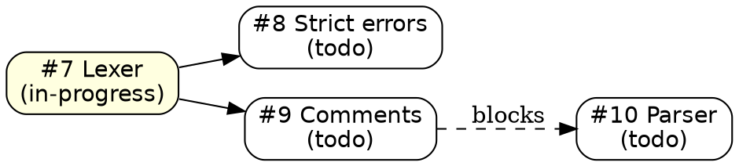

# file-issue

Convert intent into tracked, actionable issues arranged as a **tree**. One issue
= one independently verifiable unit of work. This skill only writes files under
`issues/`; it never edits the surrounding project's code.

## Layout

```
issues/
  todo.md          # tracker: Graphviz tree + status table, single source of truth
  TEMPLATE.md      # optional, copy for new issues
  0001-<slug>.md   # one file per issue (open: todo/in-progress/review, or wontfix)
  0002-<slug>.md
  done/            # completed issues are MOVED here by resolve-issue
    0003-<slug>.md
```

- Issue file name: zero-padded 4-digit id + kebab-case slug, e.g.
  `0007-lexer-strict-errors.md`.
- New issues are always created directly under `issues/`. Never create a file
  under `issues/done/` by hand — that directory is populated only by the
  `resolve-issue` skill moving an issue there once it is `done`.
- A `done` issue's file lives at `issues/done/NNNN-<slug>.md`; its id, slug and
  tracker links must still resolve (links point at the actual location).
- Next id = `max(existing ids) + 1` across **both** `issues/` and
  `issues/done/`. Never reuse, rename, or delete ids; a cancelled issue stays
  listed and marked `wontfix`.

## Issue tree

Issues form a forest of hierarchies, plus cross-cutting dependency edges:

- **`parent`** — the umbrella/epic this issue belongs to, or `null` for a root.
  Children are *derived* by scanning other issues' `parent` fields; never store a
  `children` list (it drifts). Hierarchy is structural.
- **`deps`** — blocking edges between any two issues, independent of the tree.
  `deps: [7]` means "7 must be `done` before this starts".
- An issue **with children** is an umbrella. Its acceptance criteria describe
  the whole and it is only `done` when **all** its children are `done`. Umbrella
  issues usually hold no direct implementation work; the leaves do.
- The structure must stay a **DAG**: no issue may be its own ancestor, and
  `deps` must not form a cycle.

## Workflow

1. **Gather source.** Read the user's request plus any referenced plan, spec, or
   code. If a planning document exists, mine its goals, risks, and acceptance
   criteria. Always read `issues/todo.md` and list both `issues/*.md` and
   `issues/done/*.md` first so you never duplicate an existing issue.
2. **Build the tree.** Split by *independently shippable and verifiable* work.
   Group related leaves under an umbrella parent when they serve one goal.
   Attach cross-cutting prerequisites via `deps`, not by inventing a parent.
   Collapse anything that cannot be verified on its own into its parent. If the
   request is one atomic change, produce a single root issue. If the total new
   issue count exceeds 5, confirm the shape with the user via the `question`
   tool before writing.
3. **Draft each issue** using the template below. Every issue needs at least one
   checkable acceptance criterion and the exact command or observable step that
   verifies it. No vague goals ("improve", "refactor" alone) — state the outcome.
4. **Write files** to `issues/NNNN-slug.md`. Assign ids in **pre-order** (a
   parent before its children) so the numbers read top-down.
5. **Update `issues/todo.md`** — rebuild the Graphviz block and add one table
   row per new issue. Leave existing rows and statuses untouched; keep the table
   sorted by id ascending.
6. **Report** the created ids, the tree shape, and the tracker path. State any
   assumption you made about scope, priority, or structure.

Create `issues/` and `issues/todo.md` if they do not already exist.

## Issue template

```markdown
---
id: 7
title: Short imperative title
status: todo          # todo | in-progress | review | done | wontfix
priority: high        # high | medium | low
milestone: null       # optional grouping label
parent: null          # umbrella issue id, or null for a root
deps: []              # ids that must be done first
labels: []
created: YYYY-MM-DD
---

## Context

Why this exists. Link the request, plan, or report that motivates it.

## Goal

One sentence: the outcome when this is done.

## Acceptance criteria

- [ ] Criterion 1 (observable, binary)
- [ ] Criterion 2

## Verification

The exact command(s) or manual steps that prove the criteria are met.

## Notes

Dependencies on other issue ids, open questions, non-goals.
```

## `issues/todo.md` format

Keep a `# Todo` header, then a fenced `dot` block describing the issue tree,
then the status table. Preserve any prose the user added.

````markdown
# Todo



| id  | title         | status      | priority | milestone | parent | deps |
| --- | ------------- | ----------- | -------- | --------- | ------ | ---- |
| 7   | Lexer         | in-progress | high     |           |        |      |
| 8   | Strict errors | todo        | high     |           | 7      |      |
| 9   | Comments      | todo        | medium   |           | 7      |      |
````

- `id` links to the file at its actual location: `[7](0007-short-issue-title.md)`
  for open issues, `[7](done/0007-short-issue-title.md)` once the issue is `done`
  and has been moved into `issues/done/`.
- Graph nodes: one per issue, label `#id title\n(status)`, colored by status.
  Node ids stay `"7"` regardless of which directory the file lives in.
- Tree edges: `parent -> child`, **solid**.
- Dependency edges: `blocker -> blocked`, **dashed** with `label="blocks"`.
- `parent` and `deps` columns mirror the frontmatter. `deps` lists blocking ids.
- **The table is authoritative for scanning; the graph is authoritative for
  structure.** Whenever status, parent, or deps change, update **both** the
  frontmatter, the table row, and the graph.

## Rules

- Do not close, delete, renumber, or re-slug existing issues.
- Do not create or edit anything under `issues/done/`; that directory is owned by
  `resolve-issue`, which moves issues there when they become `done`.
- When you rebuild the tracker, keep each table link pointing at the issue's
  current location (`done/NNNN-...md` for completed issues) — never rewrite a
  moved issue's link back to the root.
- Do not invent milestones or priorities the source does not support; use `null`
  (milestone/parent) or `medium` (priority) and flag the assumption.
- One concern per issue. If a draft covers two unrelated changes, split it.
- Keep the structure acyclic and every `parent`/`deps` id pointing at a real
  issue.
- Keep issue bodies self-contained: a reader must not need to open another
  document to understand the goal and how to verify it.
