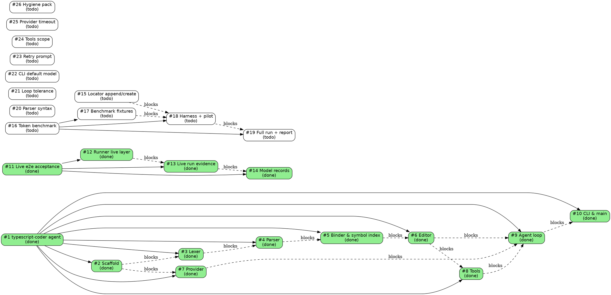

# Todo

Issue tracker for `typescript-coder`. Filed from [spec.md](../spec.md). The
tree maps relationships, the execution list drives picking, the table scans
status.

## Execution order

Open issues (todo, in-progress, review) in picking order. Repeatedly take the
highest-priority available leaf; once no leaf is available, the
highest-priority available umbrella. Available = `deps` `done` (an umbrella
also needs all children `done`). Tie-break by id.

1. #15 Append or create files when a locator's symbol is missing
2. #20 Parser: #private fields, using declarations, import attributes, const type parameters
3. #21 Loop: tolerate unparseable files instead of crashing
4. #22 CLI: default model deepseek-v4.1-flash instead of rejected deepseek
5. #17 Benchmark fixtures G1–G3 as test-only spec projects
6. #18 Benchmark harness and pilot run
7. #19 Full benchmark run and report
8. #23 Loop: correct the selection-retry prompt and echo the rejected response
9. #24 Spec: declare tools internal-only for v1 (remove loop tools plumbing)
10. #25 Provider: request timeout and runLoop error handling
11. #26 Hygiene pack: context perf/dedup, tmp skip, diagnostics edges
12. #16 Token benchmark vs opencode CLI on generation tasks (G1–G3)

| id  | title                       | status | priority | milestone | parent | deps    |
| --- | --------------------------- | ------ | -------- | --------- | ------ | ------- |
| 1   | [typescript-coder agent](done/0001-typescript-coder-agent.md) | done | medium |  |  |  |
| 2   | [Scaffold Bun/TypeScript project](done/0002-scaffold-bun-project.md) | done | medium | M0 | 1 |  |
| 3   | [Lexer with strict errors](done/0003-lexer-strict-errors.md) | done | medium | M1 | 1 | 2 |
| 4   | [Recursive-descent parser with source spans](done/0004-parser-source-spans.md) | done | medium | M2 | 1 | 3 |
| 5   | [Binder and symbol index](done/0005-binder-symbol-index.md) | done | medium | M3 | 1 | 4 |
| 6   | [Editor apply-edits and oxfmt formatting](done/0006-editor-apply-edits.md) | done | medium | M4 | 1 | 5 |
| 7   | [OpenAI-compatible provider with tools](done/0007-provider-openai.md) | done | medium | M5 | 1 | 2 |
| 8   | [Tools (rename, scroll, find-definition, check, test)](done/0008-tools.md) | done | medium | M6 | 1 | 6 |
| 9   | [Agent loop with verify, rollback, retry](done/0009-agent-loop.md) | done | medium | M7 | 1 | 6, 7, 8 |
| 10  | [CLI and main stdin entry](done/0010-cli-and-main.md) | done | medium | M8 | 1 | 9 |
| 11  | [Live end-to-end acceptance and model-record corrections](done/0011-live-e2e-acceptance.md) | done | medium |  |  |  |
| 12  | [Add live layer to the acceptance runner](done/0012-runner-live-layer.md) | done | medium |  | 11 |  |
| 13  | [Run live end-to-end acceptance and capture evidence](done/0013-live-run-evidence.md) | done | medium |  | 11 | 12 |
| 14  | [Correct model records in spec and closed issues](done/0014-correct-model-records.md) | done | medium |  | 11 | 13 |
| 15  | [Append or create files when a locator's symbol is missing](0015-append-create-missing-symbol.md) | todo | high |  |  |  |
| 16  | [Token benchmark vs opencode CLI on generation tasks (G1–G3)](0016-token-benchmark-opencode.md) | todo | high |  |  |  |
| 17  | [Benchmark fixtures G1–G3 as test-only spec projects](0017-benchmark-fixtures.md) | todo | medium |  | 16 |  |
| 18  | [Benchmark harness and pilot run](0018-benchmark-harness-pilot.md) | todo | medium |  | 16 | 15, 17 |
| 19  | [Full benchmark run and report](0019-benchmark-full-run-report.md) | todo | medium |  | 16 | 18 |
| 20  | [Parser: #private fields, using declarations, import attributes, const type parameters](0020-parser-modern-syntax.md) | todo | high |  |  |  |
| 21  | [Loop: tolerate unparseable files instead of crashing](0021-loop-tolerate-unparseable-files.md) | todo | high |  |  |  |
| 22  | [CLI: default model deepseek-v4.1-flash instead of rejected deepseek](0022-cli-default-model.md) | todo | high |  |  |  |
| 23  | [Loop: correct the selection-retry prompt and echo the rejected response](0023-selection-retry-prompt.md) | todo | medium |  |  |  |
| 24  | [Spec: declare tools internal-only for v1 (remove loop tools plumbing)](0024-tools-internal-only.md) | todo | medium |  |  |  |
| 25  | [Provider: request timeout and runLoop error handling](0025-provider-timeout-errors.md) | todo | medium |  |  |  |
| 26  | [Hygiene pack: context perf/dedup, tmp skip, diagnostics edges](0026-hygiene-context-diagnostics.md) | todo | low |  |  |  |
