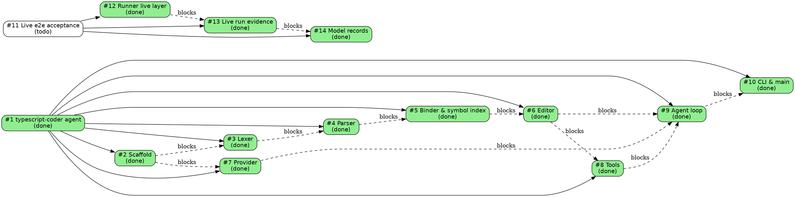

# Todo

Issue tracker for `typescript-coder`. Filed from [spec.md](../spec.md).
The table is authoritative for scanning; the graph is authoritative for
structure.

| id  | title                       | status | priority | milestone | parent | deps    |
| --- | --------------------------- | ------ | -------- | --------- | ------ | ------- |
| 1   | [typescript-coder agent](done/0001-typescript-coder-agent.md) | done | medium |  |  |  |
| 2   | [Scaffold Bun/TypeScript project](done/0002-scaffold-bun-project.md) | done | medium | M0 | 1 |  |
| 3   | [Lexer with strict errors](done/0003-lexer-strict-errors.md) | done | medium | M1 | 1 | 2 |
| 4   | [Recursive-descent parser with source spans](done/0004-parser-source-spans.md) | done | medium | M2 | 1 | 3 |
| 5   | [Binder and symbol index](done/0005-binder-symbol-index.md) | done | medium | M3 | 1 | 4 |
| 6   | [Editor apply-edits and oxfmt formatting](done/0006-editor-apply-edits.md) | done | medium | M4 | 1 | 5 |
| 7   | [OpenAI-compatible provider with tools](done/0007-provider-openai.md) | done | medium | M5 | 1 | 2 |
| 8   | [Tools (rename, scroll, find-definition, check, test)](done/0008-tools.md) | done | medium | M6 | 1 | 6 |
| 9   | [Agent loop with verify, rollback, retry](done/0009-agent-loop.md) | done | medium | M7 | 1 | 6, 7, 8 |
| 10  | [CLI and main stdin entry](done/0010-cli-and-main.md) | done | medium | M8 | 1 | 9 |
| 11  | [Live end-to-end acceptance and model-record corrections](0011-live-e2e-acceptance.md) | todo | medium |  |  |  |
| 12  | [Add live layer to the acceptance runner](done/0012-runner-live-layer.md) | done | medium |  | 11 |  |
| 13  | [Run live end-to-end acceptance and capture evidence](done/0013-live-run-evidence.md) | done | medium |  | 11 | 12 |
| 14  | [Correct model records in spec and closed issues](done/0014-correct-model-records.md) | done | medium |  | 11 | 13 |
